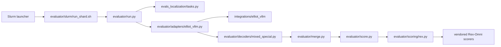

# Elliot localization evaluation

Standalone extraction of the localization evaluator used for Elliot's routine
850-query and full 228,133-query evaluations. This repository preserves the
working implementation from `elliot-mllm/elliot-vl-eval` while removing its
general VLM-evaluation and monitoring code.

## Runtime path



There is one important separation:

- `tasks.py` owns the exact prompt sent to the model;
- an adapter owns model execution and output parsing;
- the vendored Rex-Omni code owns the shared metrics.

Using the Rex scorer does **not** by itself mean a run used Rex's prompt or
native response representation. Every output row records the prompt protocol,
adapter configuration hash, raw response and normalized predictions.

## Main entry points

- `orchestration/prepare_run.py`: freeze a manifest/config/checkpoint contract
  and optionally submit an evaluation.
- `orchestration/vllm_checkpoint.sbatch`: export and run routine-850.
- `orchestration/vllm_full_32.sbatch`: export and run full-228133.
- `evaluator/run.py`: deterministic inference shard.
- `evaluator/merge.py`: validate complete, unique coverage and restore manifest
  order.
- `evaluator/score.py`: dispatch each dataset/protocol to its audited metric.

## Existing HF checkpoint

For an already exported checkpoint, set a config's `model_path` and run:

```bash
export EVAL_REPO="$PWD"
export EVAL_PYTHON=/path/to/vllm-env/bin/python
export CONFIG="$PWD/evaluator/configs/current/elliot_vllm.json"
export OUTPUT_DIR=/path/to/new/output
export EVAL_DATA=/path/to/EvalData
sbatch evaluator/slurm/vllm_benchmark.sbatch
```

The full suite accepts `MANIFEST=/path/to/full_228133.jsonl` and uses
`evaluator/slurm/vllm_full.sbatch`. The repository pins the full manifest's
identity in `manifests/full_228133_v1.json`; the large JSONL itself remains an
external benchmark artifact.

## MCore checkpoint

Use `orchestration/prepare_run.py`. It records hashes and refuses dirty source,
wrong suite sizes, mismatched manifests and duplicate submission receipts. See
`orchestration/README.md` for both commands.

## Provenance and scorer parity

The extracted inference adapter, decoder, merge logic and score dispatcher are
unchanged from source commit `b10f35ef78a99b0040c64d3ec4c5ab8d270ed6d3`.
Only repository-relative path lookups and launcher paths changed.

The following files are byte-identical to Rex-Omni commit
`6508981c1e0c3fbb2dbe7b962a4bb745005f3e2e`:

- `evals_localization/vendor/rex_omni/metrics/other_metric.py`
- `evals_localization/vendor/rex_omni/metrics/coco_lvis_metric.py`
- `evals_localization/vendor/rex_omni/utils/convert_coco_lvis_to_standard_format.py`

Run the CPU tests with:

```bash
python -m pytest -q evaluator/tests
```

GPU loading and throughput checks live under `integrations/elliot_vllm/tests/`.

## What is intentionally absent

Historical watchers, publication scripts, viewers, correction-rollout tools,
obsolete manifest builders and legacy model adapters remain in the original
repository. They are not part of the evaluator runtime.
