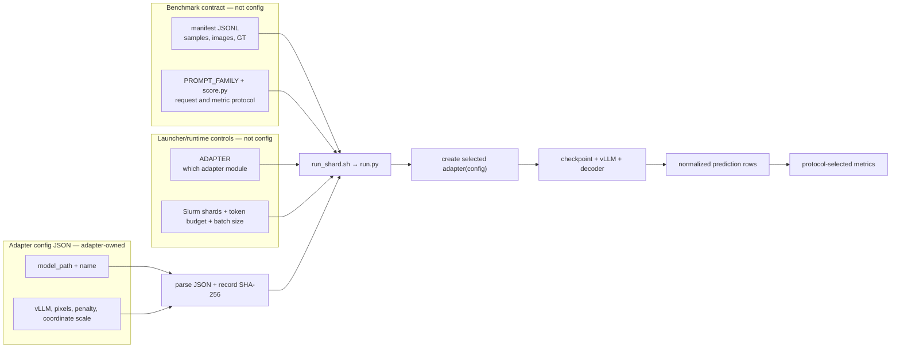

# Evaluator configurations

An adapter config is the explicit JSON argument to `run.py --adapter-config`.
`run.py` parses it, records its SHA-256 in each shard's provenance metadata,
and passes the dictionary to the selected adapter's `create_adapter(config)`.

Read the three boxes as ownership boundaries. `ADAPTER=elliot_vllm` selects
Python implementation; the JSON config supplies values to that implementation;
the manifest and prompt controls define the benchmark request. A config neither
selects a benchmark nor changes its scorer.

## Directory ownership

- `current/` — the explicitly selected Elliot release and its execution variants;
- `baselines/` — Qwen, Rex, and official LocateAnything examples;
- `legacy/` — old Transformers/Megatron experiment configurations.

`current/elliot_vllm.json` is presently **cardinality repair 70/30, local
update 500**, the selected balanced checkpoint. It points to the verified HF
export produced by Leonardo job `58552791`; that export was validated against
the source checkpoint and is also the source of the hash-verified Dropbox
release. `elliot_vllm_tp2.json` changes only tensor parallelism. The former
`corrected_sft_36000_plus100` files now live under `legacy/`.

## Current Elliot fields

| Field | Consumer | Meaning |
|---|---|---|
| `name` | `run.py` provenance | Human-readable adapter identity written to each result |
| `model_path` | `vllm.LLM` | Exported HF checkpoint to load |
| `max_model_len` | `vllm.LLM` | Maximum combined prompt/generation context |
| `max_num_seqs` | `vllm.LLM` | Maximum concurrent sequences inside one engine replica |
| `tensor_parallel_size` | `vllm.LLM` | GPUs used by one model replica; independent of Slurm shard count |
| `gpu_memory_utilization` | `vllm.LLM` | Fraction of GPU memory available to vLLM |
| `enforce_eager` | `vllm.LLM` | Whether to disable compiled/CUDA-graph execution paths |
| `min_pixels`, `max_pixels` | Elliot HF override and geometry check | Allowed native-resolution image budget |
| `repetition_penalty` | Elliot logits processor | Greedy-generation repetition penalty |
| `coordinate_max` | spatial decoder | Normalized coordinate-token range, currently `0..1000` |
| `output_format` | Elliot adapter | Selects the reviewed decoder/prompt suffix; current release uses `mixed_special_xyxy_grouped_all_instances_v2` |

The config does **not** control:

- benchmark membership or ground truth — the manifest does;
- prompt wording/family — `evals_localization/tasks.py` and `PROMPT_FAMILY` do;
- output `max_new_tokens` or batch size — the Slurm launcher does;
- number of dataset shards — Slurm's `--ntasks` does;
- metrics — `score.py` and the manifest's evaluation metadata do.

## Selection and freezing

The routine launcher requires `CONFIG=/path/to/config.json`. A prepared full
run copies the chosen JSON to `run/inputs/config.json`, and the full launcher
uses that fixed file. Files under `current/` are explicit reusable launch
defaults, but the launcher still selects one through `CONFIG`; merely adding a
file does not activate it. Historical results remain reproducible from the
configs frozen inside their own run directories.
