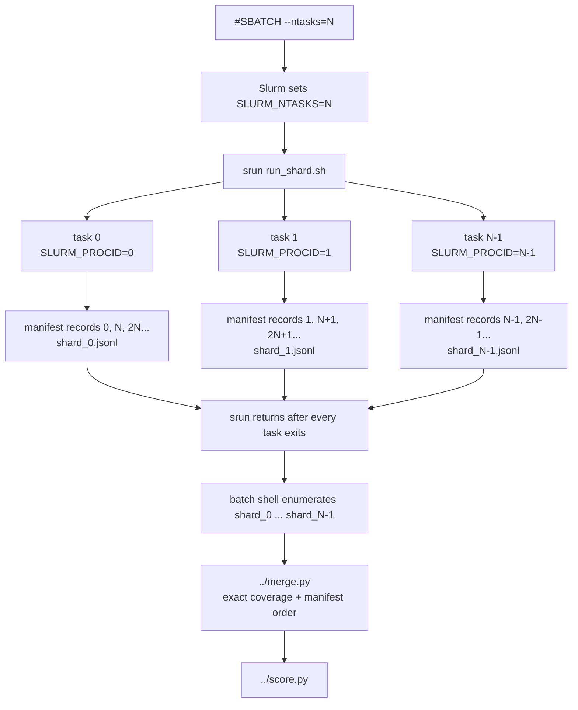

# Current Slurm launchers



## Where the Slurm variables come from

`sbatch` reads the `#SBATCH` header before starting the script. For the routine
launcher, `#SBATCH --ntasks=4` creates a four-task allocation and exports
`SLURM_NTASKS=4`; the full launcher analogously exports `SLURM_NTASKS=16`.
Slurm would also use that variable as `srun`'s default task count, but both
launchers pass `--ntasks="$SLURM_NTASKS"` explicitly so the behavior is visible
in the command itself.

Slurm gives every launched process:

- `SLURM_PROCID`: unique global rank from `0` through `SLURM_NTASKS-1`;
- `SLURM_NTASKS`: total number of ranks in this `srun`;
- `SLURM_LOCALID`: rank on the current node, used to select its GPU.

These are Slurm-defined variables, documented in the official
[`sbatch` output environment variables](https://slurm.schedmd.com/sbatch.html#SECTION_OUTPUT-ENVIRONMENT-VARIABLES).

## `run_shard.sh` input contract

```text
run_shard.sh EVALUATOR_DIR MANIFEST.jsonl CONFIG.json OUTPUT_DIR LIMIT
```

`ADAPTER` is also required in the environment; there is deliberately no
implicit adapter fallback. The wrapper exits with a named error before loading
the model when an argument/environment variable is absent, a path is unreadable,
the config is not a JSON object, a numeric control is invalid, no GPU is
assigned to a vLLM adapter, or the output directory cannot be written.

The launchers own these inputs: `vllm_benchmark.sbatch` receives `CONFIG` and
`OUTPUT_DIR` from submission and pins `ADAPTER=elliot_vllm`; `vllm_full.sbatch`
reads the manifest and config frozen under `RUN_DIR/inputs/`. The wrapper only
validates and forwards them—it does not choose a checkpoint or benchmark.

`run_shard.sh` passes the first two values to `run.py`. The Python sharding rule
is `records[shard_index::num_shards]`, a stable strided partition. After the
blocking `srun` completes, the parent batch shell uses `SLURM_NTASKS` to build
the exact list of expected shard filenames. `merge.py` then checks exact sample
coverage and emits records in manifest order before `score.py` runs.

Current evaluations make exactly one generation attempt per sample. They do
not set or forward `RETRY_MAX_NEW_TOKENS`; token-cap retry support is isolated
with the historical launchers under `legacy/evaluator/`.

These are the only current Slurm launchers. Old discrete-NTP/VisDrone jobs are
under `../../legacy/evaluator/jobs/`; external model baseline jobs are
under `../../baselines/jobs/`.
