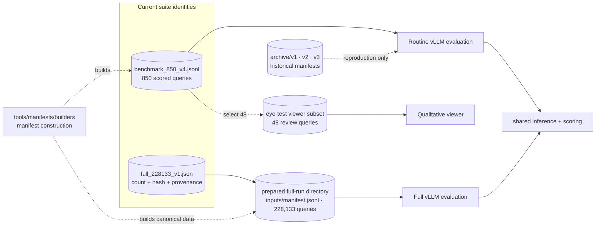

# Evaluation manifests

This level represents the two current evaluation suites:

- `benchmark_850_v4.jsonl` — the fixed 850-query routine evaluation;
- `full_228133_v1.json` — the immutable identity and provenance record for the
  full 228,133-query evaluation.

`smoke_manifest_7_v1.jsonl` is a smoke-test manifest with seven queries copied
unchanged from routine-850, one per localization family, selecting the minimum
`(target_count, sample_id)` per family. Rows reference existing images and include
targets and ground truth. Use it to check inference, decoding and scoring; its
scores are not benchmark performance estimates.

The full JSONL is 416,361,681 bytes, above GitHub's normal single-file limit.
Therefore each prepared full run carries an exact frozen copy at
`inputs/manifest.jsonl`; the checked-in record pins its row count, group count,
byte size, SHA-256, builder, and canonical Leonardo source. This prevents a
large generated data file from bloating every clone without hiding its identity.

The 48-row visual-review subset is not a benchmark. It lives with its consumer
at `reporting/eye_test/manifests/qualitative_48_v4.jsonl`.

The important distinction is that the routine suite reads the visible V4 JSONL
from this checkout, while every full-suite run reads a frozen copy verified
against `full_228133_v1.json`. The qualitative subset only builds a viewer.
Files under `archive/` remain available for historical reproduction but are not
current defaults.
