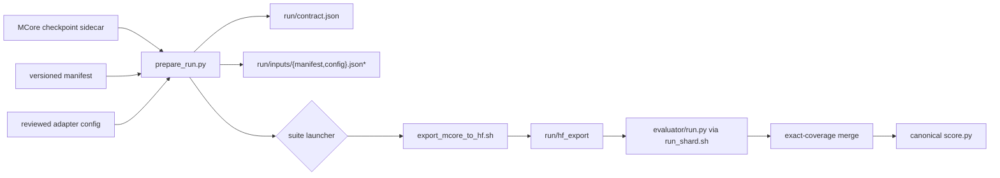
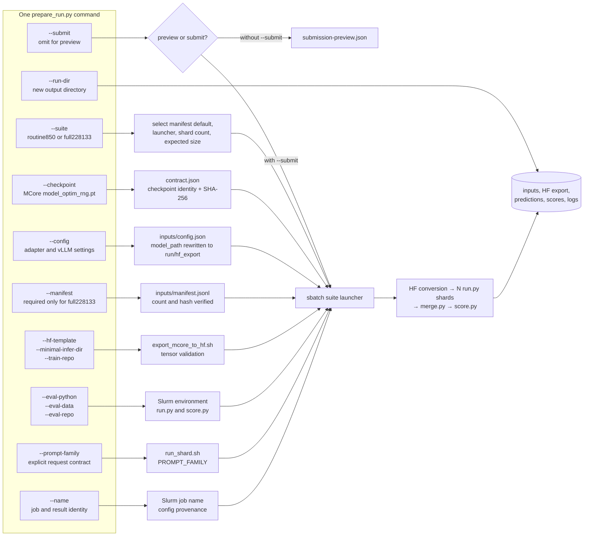
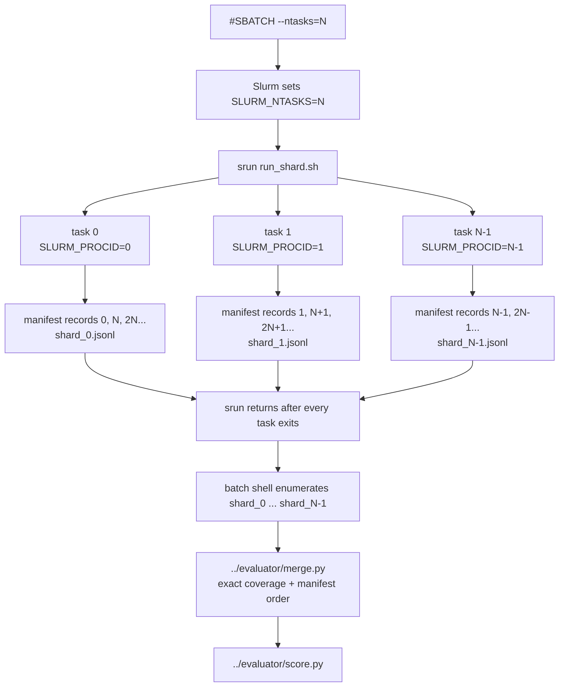

# Evaluation orchestration

This directory is the checked-in replacement for the one-off `prepare.py`,
`finish.py`, and copied Slurm files that were used for the September 2026
localization campaign.

The evaluator runtime remains in `../evaluator/`.  Orchestration is the layer
that turns an MCore checkpoint into an immutable evaluation run:



## Command arguments and ownership

`prepare_run.py` is the only user-facing entry point for an MCore checkpoint.
The diagram below shows where every CLI argument goes; the submitted Slurm job
performs conversion, sharded inference, merging, and scoring.



## Why this exists

The published runs were valid, but their control plane was fragmented:

- routine 850 runs were prepared by local, untracked `exports/*/prepare.py`
  scripts and an untracked Leonardo `vllm_checkpoint.sbatch`;
- full 228,133-query runs copied a prior run directory, froze a source tree,
  rewrote paths, and used 32 resumable shards even though the repository
  template still described 16;
- `controller/monitor.py` still submitted the legacy Transformers/Megatron
  launcher.  It did not submit the recent vLLM evaluations.

That is why reading only the repository could not explain a published run.
The reusable MCore export, routine launcher, 32-shard full launcher, and run
preparation are now tracked here. FindIt uses a separate `lmms_eval` pipeline
and is deliberately outside this consolidation.

## Reproducible run contract

`prepare_run.py` freezes the manifest and adapter config into the run folder,
records their SHA-256 hashes, records the evaluator Git commit, and refuses a
dirty evaluator checkout.
It never infers a prompt family or token budget. The current adapter always
uses the tracked special-token box/point decoder; the prompt family defines the
requested response contract.
Both launchers call `verify_run.py` before export or model load. It rehashes the
checkpoint, manifest, and config; checks sample/group counts, prompt family,
model path, and evaluator commit; and exits nonzero on any drift.

The prepared config must name `output_format`. For the selected cardinality
repair release this is `mixed_special_xyxy_grouped_all_instances_v2`; omitting
it would select the legacy ref/box decoder and is rejected during preparation.

### Routine 850

Preview first:

```bash
python3 orchestration/prepare_run.py \
  --suite routine850 \
  --checkpoint /path/to/iter_0000500/mp_rank_00/model_optim_rng.pt \
  --run-dir /scratch/evaluations/auto/my-run/step_00000500 \
  --config evaluator/configs/current/elliot_vllm.json \
  --hf-template /path/to/reviewed/hf-template \
  --minimal-infer-dir /path/to/minimal_caption_infer \
  --eval-python /path/to/vllm-env/bin/python \
  --eval-data /path/to/EvalData \
  --prompt-family elliot-loc \
  --name my-routine-eval
```

Inspect `contract.json` and `submission-preview.json`, then repeat the same
command with `--submit`. Routine evaluation uses the tracked 850-row manifest
and four TP=1 GPU shards.

### Full 228,133-query suite

The full suite requires the frozen manifest whose identity is pinned by
`../manifests/full_228133_v1.json`:

```bash
python3 orchestration/prepare_run.py \
  --suite full228133 \
  --checkpoint /path/to/iter_0000500/mp_rank_00/model_optim_rng.pt \
  --run-dir /scratch/evaluations/full/my-run \
  --manifest /path/to/frozen/full_228133_manifest.jsonl \
  --config evaluator/configs/current/elliot_vllm.json \
  --hf-template /path/to/reviewed/hf-template \
  --minimal-infer-dir /path/to/minimal_caption_infer \
  --eval-python /path/to/vllm-env/bin/python \
  --eval-data /path/to/EvalData \
  --prompt-family elliot-loc \
  --name my-full-eval
```

Again, inspect the preview and repeat with `--submit`. Full evaluation uses 32
TP=1 GPU shards and requires exactly 228,133 samples in 44 groups. Conversion
is part of the submitted job; do not run a separate login-node conversion.

Re-running a prepared command with `--submit` refuses to create a second job
when `submission.json` already exists.

`--eval-repo` defaults to the checkout containing this file and `--train-repo`
defaults to the Leonardo training checkout. Pass either explicitly when using
a different clean checkout; both resolved paths are recorded in the contract.

## Historical evidence versus reusable source

Generated predictions, logs, W&B payloads, publication receipts, and recovery
receipts remain run artifacts; they should not be copied into Git.  A run is
auditable from:

1. this tracked orchestration and evaluator commit;
2. its frozen `inputs/` files and `contract.json`;
3. its `submission.json` / Slurm record;
4. shard metadata and the final publication receipt.

The former local `exports/` tree remains historical evidence, not executable
source of truth.

## Slurm launchers and shard execution



### Where the Slurm variables come from

`sbatch` reads the `#SBATCH` header before starting the script. For the routine
launcher, `#SBATCH --ntasks=4` creates a four-task allocation and exports
`SLURM_NTASKS=4`; the full launcher analogously exports `SLURM_NTASKS=16`.
The MCore full-suite launcher `vllm_full_32.sbatch` uses 32 tasks.
Slurm would also use that variable as `srun`'s default task count, but both
launchers pass `--ntasks="$SLURM_NTASKS"` explicitly so the behavior is visible
in the command itself.

Slurm gives every launched process:

- `SLURM_PROCID`: unique global rank from `0` through `SLURM_NTASKS-1`;
- `SLURM_NTASKS`: total number of ranks in this `srun`;
- `SLURM_LOCALID`: rank on the current node, used to select its GPU.

These are Slurm-defined variables, documented in the official
[`sbatch` output environment variables](https://slurm.schedmd.com/sbatch.html#SECTION_OUTPUT-ENVIRONMENT-VARIABLES).

### `run_shard.sh` input contract

```text
run_shard.sh EVALUATOR_DIR MANIFEST.jsonl CONFIG.json OUTPUT_DIR LIMIT
```

`ADAPTER` is also required in the environment; there is deliberately no
implicit adapter fallback. The wrapper exits with a named error before loading
the model when an argument/environment variable is absent, a path is unreadable,
the config is not a JSON object, a numeric control is invalid, no GPU is
assigned to a vLLM adapter, or the output directory cannot be written.

The launchers own these inputs: `vllm_benchmark.sbatch` receives `CONFIG` and
`OUTPUT_DIR` from submission and pins `ADAPTER=elliot_vllm`; `vllm_full.sbatch`
reads the manifest and config frozen under `RUN_DIR/inputs/`. The wrapper only
validates and forwards them—it does not choose a checkpoint or benchmark.

`run_shard.sh` passes the first two values to `run.py`. The Python sharding rule
is `records[shard_index::num_shards]`, a stable strided partition. After the
blocking `srun` completes, the parent batch shell uses `SLURM_NTASKS` to build
the exact list of expected shard filenames. `merge.py` then checks exact sample
coverage and emits records in manifest order before `score.py` runs.

Current localization launchers make exactly one generation attempt per sample.
The shard wrapper does not set or forward `RETRY_MAX_NEW_TOKENS`.
