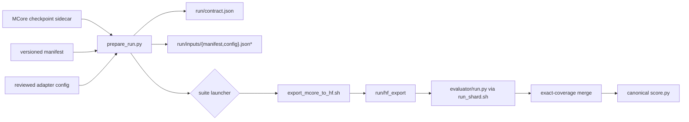
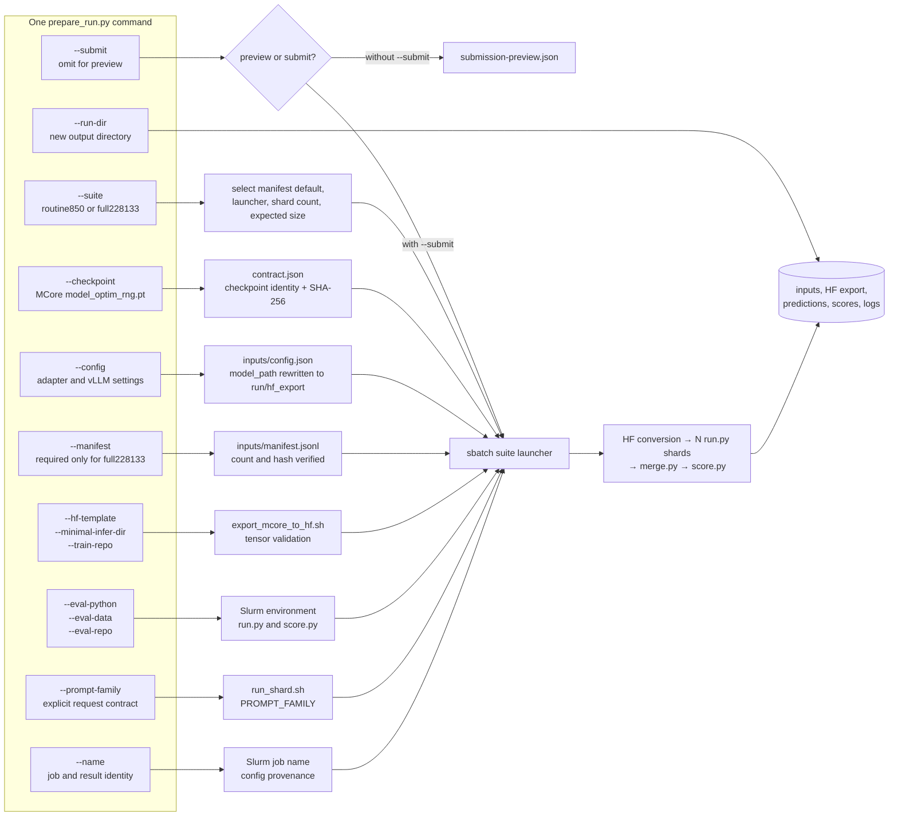

# Evaluation orchestration

This directory is the checked-in replacement for the one-off `prepare.py`,
`finish.py`, and copied Slurm files that were used for the September 2026
localization campaign.

The evaluator runtime remains in `../evaluator/`.  Orchestration is the layer
that turns an MCore checkpoint into an immutable evaluation run:



## Command arguments and ownership

`prepare_run.py` is the only user-facing entry point for an MCore checkpoint.
The diagram below shows where every CLI argument goes; the submitted Slurm job
performs conversion, sharded inference, merging, and scoring.



## Why this exists

The published runs were valid, but their control plane was fragmented:

- routine 850 runs were prepared by local, untracked `exports/*/prepare.py`
  scripts and an untracked Leonardo `vllm_checkpoint.sbatch`;
- full 228,133-query runs copied a prior run directory, froze a source tree,
  rewrote paths, and used 32 resumable shards even though the repository
  template still described 16;
- `controller/monitor.py` still submitted the legacy Transformers/Megatron
  launcher.  It did not submit the recent vLLM evaluations.

That is why reading only the repository could not explain a published run.
The reusable MCore export, routine launcher, 32-shard full launcher, and run
preparation are now tracked here. FindIt uses a separate `lmms_eval` pipeline
and is deliberately outside this consolidation.

## Reproducible run contract

`prepare_run.py` freezes the manifest and adapter config into the run folder,
records their SHA-256 hashes, records the evaluator Git commit, and refuses a
dirty evaluator checkout.
It never infers a prompt family or token budget. The current adapter always
uses the tracked special-token box/point decoder; the prompt family defines the
requested response contract.
Both launchers call `verify_run.py` before export or model load. It rehashes the
checkpoint, manifest, and config; checks sample/group counts, prompt family,
model path, and evaluator commit; and exits nonzero on any drift.

The prepared config must name `output_format`. For the selected cardinality
repair release this is `mixed_special_xyxy_grouped_all_instances_v2`; omitting
it would select the legacy ref/box decoder and is rejected during preparation.

### Routine 850

Preview first:

```bash
python3 orchestration/prepare_run.py \
  --suite routine850 \
  --checkpoint /path/to/iter_0000500/mp_rank_00/model_optim_rng.pt \
  --run-dir /scratch/evaluations/auto/my-run/step_00000500 \
  --config evaluator/configs/current/elliot_vllm.json \
  --hf-template /path/to/reviewed/hf-template \
  --minimal-infer-dir /path/to/minimal_caption_infer \
  --eval-python /path/to/vllm-env/bin/python \
  --eval-data /path/to/EvalData \
  --prompt-family elliot-loc \
  --name my-routine-eval
```

Inspect `contract.json` and `submission-preview.json`, then repeat the same
command with `--submit`. Routine evaluation uses the tracked 850-row manifest
and four TP=1 GPU shards.

### Full 228,133-query suite

The full suite requires the frozen manifest whose identity is pinned by
`../manifests/full_228133_v1.json`:

```bash
python3 orchestration/prepare_run.py \
  --suite full228133 \
  --checkpoint /path/to/iter_0000500/mp_rank_00/model_optim_rng.pt \
  --run-dir /scratch/evaluations/full/my-run \
  --manifest /path/to/frozen/full_228133_manifest.jsonl \
  --config evaluator/configs/current/elliot_vllm.json \
  --hf-template /path/to/reviewed/hf-template \
  --minimal-infer-dir /path/to/minimal_caption_infer \
  --eval-python /path/to/vllm-env/bin/python \
  --eval-data /path/to/EvalData \
  --prompt-family elliot-loc \
  --name my-full-eval
```

Again, inspect the preview and repeat with `--submit`. Full evaluation uses 32
TP=1 GPU shards and requires exactly 228,133 samples in 44 groups. Conversion
is part of the submitted job; do not run a separate login-node conversion.

Re-running a prepared command with `--submit` refuses to create a second job
when `submission.json` already exists.

`--eval-repo` defaults to the checkout containing this file and `--train-repo`
defaults to the Leonardo training checkout. Pass either explicitly when using
a different clean checkout; both resolved paths are recorded in the contract.

## Small smoke test with an existing HF export

`manifests/smoke_manifest_7_v1.jsonl` is a smoke-test manifest: a list of seven
evaluation queries copied unchanged from the routine-850 manifest
`benchmark_850_v4.jsonl`, one per localization family. Each row identifies an
image, the requested categories or target, ground truth and scoring protocol;
it references existing images rather than containing image data. Within each family the
selection minimizes `(target_count, sample_id)`. It covers box, point and GUI
protocols while keeping generation small. Its scores only check that inference,
decoding, merge and scoring execute; they are not benchmark performance estimates.
Image paths retain the existing Leonardo EvalData location.

The first smoke target is the cardinality-repair local-500 HF export already
named in `evaluator/configs/current/elliot_vllm.json`. It uses that config's
mixed-special grouped output, 0–1000 coordinates, 4 MP image cap, 16K context and
1.05 repetition penalty. This does not establish compatibility with the separate
native-processing plugin used by later post-training and recovery runs.

From a committed, pushed checkout on Leonardo, inspect the config, confirm its
model and manifest images exist, and check existing jobs and run records first.
The following is a command to review, not authorization to submit:

```bash
export EVAL_REPO="$PWD"
export EVAL_PYTHON=/leonardo_work/EUHPC_E07_125/nas/envs/elliot-vllm-eval/bin/python
export EVAL_DATA=/leonardo_scratch/large/userexternal/auselis0/elliot-locate-eval/EvalData
export CONFIG="$EVAL_REPO/evaluator/configs/current/elliot_vllm.json"
export MANIFEST="$EVAL_REPO/manifests/smoke_manifest_7_v1.jsonl"
export OUTPUT_DIR=/path/to/new/durable/elliot-cardinality500-smoke7-v1
export PROMPT_FAMILY=elliot-loc BATCH_SIZE=1 MAX_NEW_TOKENS=4096
export EXPECTED_MANIFEST_SHA256="$(sha256sum "$MANIFEST" | cut -d ' ' -f 1)"
export EXPECTED_GROUP_COUNT=7
mkdir -p "$OUTPUT_DIR/logs"
sbatch --job-name=elliot-smoke7 --ntasks=1 --ntasks-per-node=1 \
  --time=00:20:00 --output="$OUTPUT_DIR/logs/%x-%j.out" \
  --error="$OUTPUT_DIR/logs/%x-%j.err" evaluator/slurm/vllm_benchmark.sbatch
```

This reuses the existing launcher with one GPU and no token-cap retry. The
launcher selects this checkout's Elliot plugin even when the shared environment
has an editable installation pointing elsewhere, and verifies the import before
starting inference. The compiled scorer and EvalData must also be available.

After an authorized submission, follow `AGENTS.md` to record the command,
revisions, job and artifact paths in `runs/`. Check all seven IDs occur exactly
once, no error rows, raw responses and box/point geometry, token-cap hits and
seven scored groups. Empty predictions and token-cap hits require inspection;
an exit code alone does not establish correct decoding or useful model output.

## Historical evidence versus reusable source

Generated predictions, logs, W&B payloads, publication receipts, and recovery
receipts remain run artifacts; they should not be copied into Git.  A run is
auditable from:

1. this tracked orchestration and evaluator commit;
2. its frozen `inputs/` files and `contract.json`;
3. its `submission.json` / Slurm record;
4. shard metadata and the final publication receipt.

The former local `exports/` tree remains historical evidence, not executable
source of truth.
